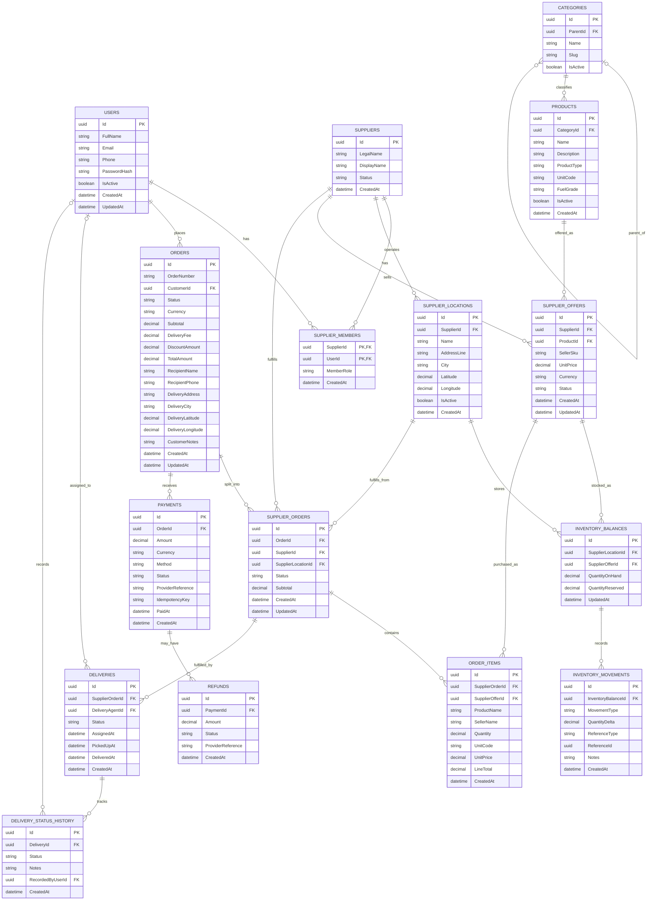

# InstaFuel Database Schema

## Overview

InstaFuel uses PostgreSQL as its relational database and Entity Framework Core (EF Core) as its Object-Relational Mapper (ORM).

The database supports the fuel marketplace, including customers, suppliers, products, inventory, orders, payments, refunds, and deliveries.

## Entity Relationship Diagram

## Entity Responsibilities

| Entity | Responsibility |
|---|---|
| Users | Stores customer, supplier-member, and delivery-agent user accounts. |
| Suppliers | Stores supplier business information. |
| SupplierMembers | Associates users with suppliers and their membership roles. |
| SupplierLocations | Stores supplier branches or fuel station locations. |
| Categories | Organizes products into a hierarchical category structure. |
| Products | Defines the products available in the marketplace. |
| SupplierOffers | Defines which products a supplier sells and at what price. |
| InventoryBalances | Tracks stock and reserved quantities for offers at locations. |
| InventoryMovements | Records inventory quantity changes. |
| Orders | Represents the customer's overall order. |
| SupplierOrders | Represents the supplier-specific portion of an order. |
| OrderItems | Stores individual items in a supplier order. |
| Payments | Tracks payment attempts and payment status. |
| Refunds | Tracks refunds associated with payments. |
| Deliveries | Tracks delivery assignment and fulfillment. |
| DeliveryStatusHistory | Records delivery status changes. |

## Key Relationships

- A user can belong to multiple suppliers through `SupplierMembers`.
- A supplier can operate multiple locations and publish multiple offers.
- A category can contain child categories and multiple products.
- A product can have offers from different suppliers.
- Inventory is tracked for a supplier offer at a supplier location.
- A customer order can be divided into multiple supplier orders.
- Each supplier order contains order items and can have delivery records.
- An order can have multiple payment records.
- A payment can have multiple refunds.
- A delivery can have multiple status-history records.

## Implementation Notes

- Entity identifiers use `Guid`, which maps to PostgreSQL UUID values through EF Core and Npgsql.
- Nullable properties represent optional data where defined in the application models.
- Monetary amounts use decimal precision appropriate for financial values.
- Inventory quantities use decimal precision to support fractional quantities.
- `InventoryMovement.ReferenceType` and `ReferenceId` are reference metadata; they should not be interpreted as a conventional foreign-key relationship without additional configuration.
- This diagram documents the intended entity relationships from the application models. Verify EF Core configuration and applied migrations before treating it as an exact representation of the deployed database.