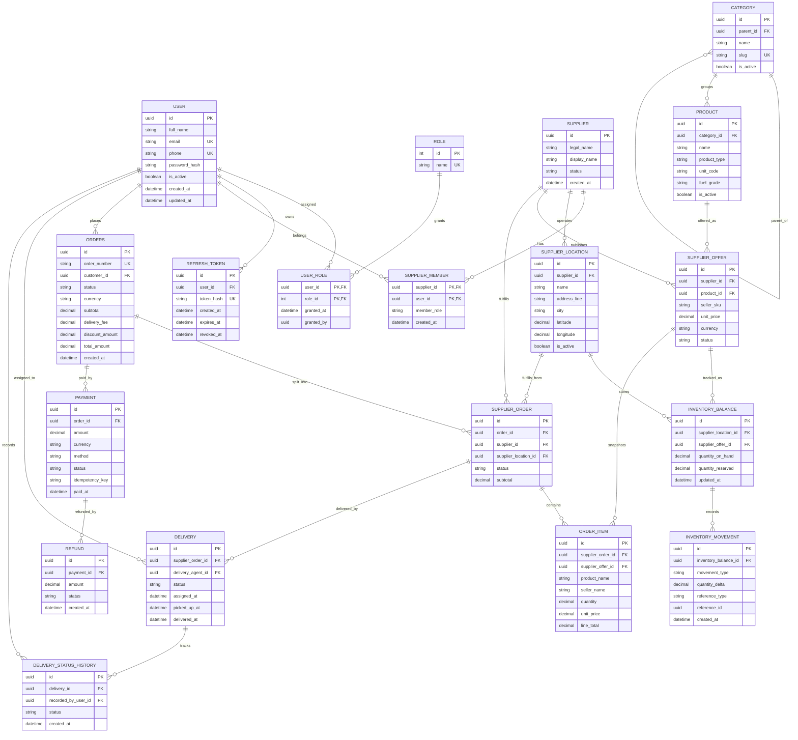

# InstaFuel Database Schema

The current API uses one PostgreSQL database managed by Entity Framework Core.
This diagram reflects the existing EF Core entities and relationships. It does
not imply that endpoints or workflows for every entity are implemented.

`user_roles` and `supplier_members` use composite primary keys. Role names and
statuses are currently stored as strings. The entity configurations define
the database constraints, indexes, and delete behavior.
