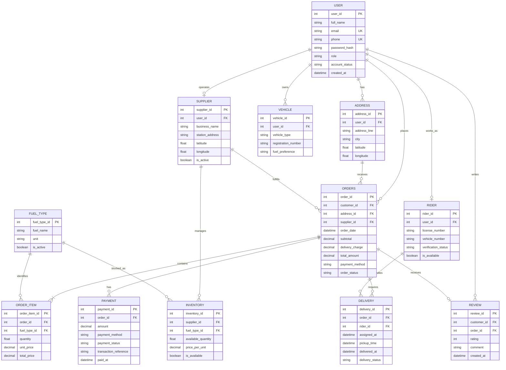

Since your **Fuel On-Demand** project uses FastAPI and PostgreSQL with a microservice architecture, here is a sample database schema in **Mermaid ER diagram format**.

You can paste this code into the [Mermaid Live Editor](https://mermaid.live/) to visualize the database relationships.

### Sample Database Schema — Fuel On-Demand

### How to understand this diagram

**1. USER — The central entity**

The `USER` table stores common account information. A user can have a customer, rider, or supplier role. Sector Supervisors, Admins, and Super Admins can also have accounts.

**2. FUEL_TYPE and INVENTORY — Fuel management**

- `FUEL_TYPE` stores Petrol, Diesel, Octane, and Gas Cylinder.
- `INVENTORY` tracks how much fuel each supplier has available and its price.
- One supplier can stock multiple fuel types.

**3. ORDERS and ORDER_ITEM — Order management**

These tables represent different concepts:

- `ORDERS` stores the overall order, including the customer, supplier, delivery address, and total amount.
- `ORDER_ITEM` stores the individual fuel products and quantities included in that order.

For example, one order might contain 10 litres of Petrol and 5 litres of Diesel. The order has one record in `ORDERS` and two records in `ORDER_ITEM`.

**4. PAYMENT — Payment processing**

The `PAYMENT` table stores payment details for online payments and Cash on Delivery (COD). The payment status can be `PENDING`, `PAID`, `FAILED`, or `REFUNDED`.

**5. RIDER and DELIVERY — Delivery management**

- `RIDER` stores rider-specific information and verification status.
- `DELIVERY` connects an order with the rider responsible for delivering it.

Separating `DELIVERY` from `ORDERS` makes it possible to track delivery progress independently of the order's overall status.

### Important considerations for your actual project

This is a **sample relational schema**, not the final production database design.

For Fuel On-Demand, I recommend considering these improvements when developing the actual system:

| Requirement | Recommended approach |
|---|---|
| Multiple user roles | Use a role/permission system instead of relying only on a role string. |
| Sector Supervisors | Add `SECTOR` and `SECTOR_SUPERVISOR` relationships. |
| Rider preferred areas | Create `RIDER_PREFERRED_AREA` and `DELIVERY_AREA` tables. |
| Supplier inventory | Add inventory transaction records to track stock changes. |
| Refunds | Create a separate `REFUND` table. |
| Order status history | Create an `ORDER_STATUS_HISTORY` table. |
| Notifications | Create a `NOTIFICATION` table. |
| Online payments | Store gateway references and payment event records securely. |
| Microservice architecture | Define clear ownership of tables and data between services. |

**One important architecture note:** Since you're planning to use microservices with FastAPI and PostgreSQL, this diagram represents the logical relationships across the system. In production, the tables may belong to different service-owned databases rather than one shared database. For example, the Order Service would own order records, while the Delivery Service would own delivery records.

For your first implementation, you can begin with a single PostgreSQL database and separate FastAPI modules, then split the databases into independently owned services as the project grows.